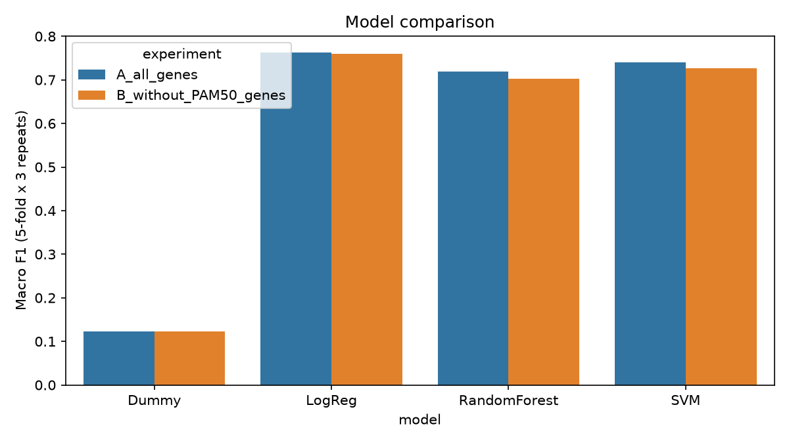
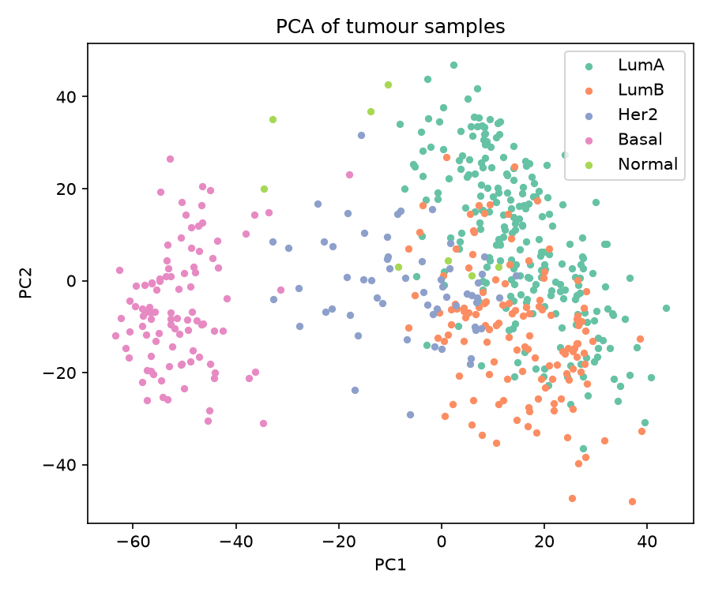

# Machine Learning Classification of Breast Cancer Molecular Subtypes (TCGA-BRCA, PAM50)

Multiclass classification of PAM50 molecular subtypes (LumA, LumB, Her2, Basal, Normal-like) from gene expression in TCGA-BRCA, with leakage-controlled cross-validation and a PAM50-gene-exclusion experiment.

## Data
From the TCGA breast cancer (2012) publication page at NCI GDC: https://gdc.cancer.gov/about-data/publications/brca_2012
- `BRCA.exp.547.med.txt`: median-centred expression, 17,814 genes x 547 samples
- `BRCA.547.PAM50.SigClust.Subtypes.txt`: PAM50 subtype labels

Raw data is not included in this repository; download it from the link above into `data/raw/`.

## Methods
- All 547 samples matched by full TCGA barcode. 22 adjacent-normal and 3 metastatic samples were excluded, leaving 522 primary tumours (LumA 231, LumB 127, Basal 98, Her2 58, Normal-like 8).
- Pipeline (fit on training folds only): median imputation, zero-variance filter, standardisation, ANOVA top-300 gene selection, classifier.
- Models: Logistic Regression, Random Forest, linear SVM, plus a majority-class baseline.
- Evaluation: stratified 5-fold cross-validation repeated 3 times; accuracy, balanced accuracy, macro F1, per-class report, confusion matrices.
- Experiment A uses all genes. Experiment B removes the 50 PAM50 genes.

## Results (mean over 15 folds)
| Experiment | Model | Accuracy | Balanced acc. | Macro F1 |
|---|---|---|---|---|
| A (all genes) | Baseline | 0.443 | 0.200 | 0.123 |
| A | Logistic Regression | 0.872 | 0.784 | 0.763 |
| A | Random Forest | 0.869 | 0.713 | 0.719 |
| A | SVM | 0.868 | 0.745 | 0.740 |
| B (no PAM50 genes) | Logistic Regression | 0.866 | 0.778 | 0.760 |
| B | Random Forest | 0.857 | 0.695 | 0.702 |
| B | SVM | 0.857 | 0.732 | 0.726 |

Per-class F1 (Logistic Regression, A): Basal 0.975, LumA 0.912, LumB 0.795, Her2 0.766, Normal-like 0.478.
All figures are in `results/figures`, metrics in `results/metrics`.




## Interpretation
Top Logistic Regression genes per subtype include oestrogen-receptor-linked genes (e.g. GREB1, GFRA1, PGR) for LumA, cell-cycle genes (e.g. MASTL, BIRC5, PRC1) for LumB/Her2, and basal-associated genes (e.g. FOXC1, SFRP1) for Basal. These are statistical associations, not evidence of causation.

## Limitations
- PAM50 labels are derived from expression, so some circularity is unavoidable. Performance without PAM50 genes is similar because many other genes are co-expressed with them; this shows redundancy of subtype signal, not independent subtype discovery.
- Normal-like has only 8 tumour samples, so its metrics are unreliable.
- Hyperparameters were fixed, not tuned. Single dataset, no external validation.

## Future work
Nested-CV hyperparameter tuning, external validation on another cohort (e.g. the TCGA STAR-TPM data), a 4-class analysis excluding Normal-like, pathway enrichment of top genes.

## Reproduce
```
pip install -r requirements.txt
python src/prepare_data.py
python src/eda.py
python src/model_train.py
python src/interpret.py
**Author:** Vaishnavi Sharma``